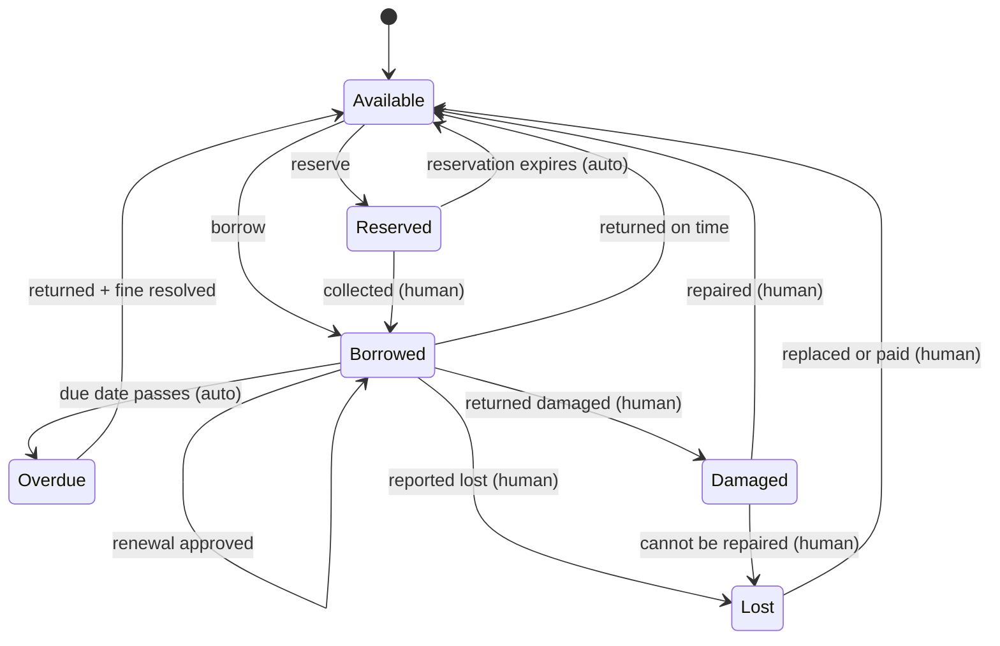
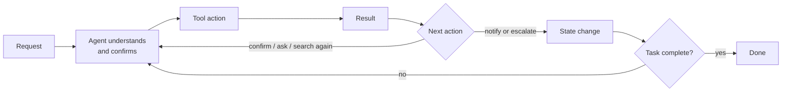

# AI Library Management Agent: Project Specification

## Problem and proposed solution

Some students don't write an entry in the library register when they borrow books, even when they are made to queue. Writing in registers by hand is slow and often incomplete.

**Who is affected:** the library committee and its in-charge facilitator.

**Proposed solution:** an AI agent that keeps a database. Entries are typed or voice-dictated. The agent:

- shows whether each book is in the library or with a student
- raises a **red alert** when a book is not returned by the due date
- if it is still not returned, **emails the school mail ID** with the number of unreturned books
- sends a **pay-up (fine) message** for a torn or damaged book
- shows **total and current** books

---

## Layer 1: User

| | |
|---|---|
| **Primary users** | Library committee members |
| **Not users** | Students, the in-charge facilitator and school management. They benefit but do not operate the agent. |
| **Main frustration** | There is no reliable, quick way to register people and book names. |

## Layer 2: Entity

The agent manages the **library register** and the process of taking and returning books, using a digital database.

**Information it holds**

- Student name and grade
- Book name
- Total and current books
- Book status, and who has each book
- Take and due dates
- Who has not yet returned their book

**Due date:** 7 days (Friday to Friday). The agent sends it to the student as a reminder.

**What changes over time:** borrower, in-charge person, book condition, book status, due date (for example around festivals), and the collected data.

## Layer 3: State

**Book states:** `Available`, `Borrowed`, `Reserved`, `Overdue`, `Returned`, `Lost`, `Damaged`

### Key transitions

| From | To | When | Who |
|---|---|---|---|
| Available | Borrowed | A student borrows | Agent records, human approves |
| Available | Reserved | A student reserves | Agent |
| Reserved | Borrowed | The student collects it | Human |
| Reserved | Available | The reservation expires | Automatic |
| Borrowed | Available | Returned on time | Agent records, human approves |
| Borrowed | Overdue | The due date passes | Automatic |
| Borrowed | Borrowed | A renewal is approved | Human approves |
| Borrowed | Lost | Reported lost | Human |
| Borrowed | Damaged | Returned damaged | Human |
| Overdue | Available | Returned and the fine is resolved | Human |
| Lost | Available | The student replaces or pays for the book | Human |
| Damaged | Available | Repaired | Human |
| Damaged | Lost / Damaged | It cannot be repaired | Human |
| *Any* | *Any* | A librarian corrects it | Librarian |

**Always tracked:** registration data, due-date notices, new books, book status and availability, fine details, and damage reports.

## Layer 4: Memory

### Remember

- Previous borrowing
- Overdue history
- Unpaid fines
- Reservation history
- Lost or damaged books

### Remember human decisions

- Special borrowing approvals
- Renewal approvals
- Fines waived or reduced
- Lost-book confirmations
- Damage assessments

### How memory influences future decisions

- Unpaid fines can affect whether a student may borrow.
- A student's past damaged book must **not** automatically mean that a newly damaged book can't be repaired.
- A past renewal approval can guide similar cases, but the current reservation status and due date must still be checked.

### Never store

- Passwords or login credentials
- Unnecessary personal information
- Errors that have already been resolved
- Unverified accusations about users
- Sensitive personal data not needed for library work

## Layer 5: Knowledge

| Source | Notes |
|---|---|
| Library rules and borrowing policies | |
| Book catalogue and availability | Changes with every borrow, return or reservation |
| Borrowing limits and loan periods | |
| Fine and overdue policies | Confidential if restricted |
| Book repair and replacement guidelines | |

**When the agent doesn't know something**, it tries these in order:

1. Search the register and rules
2. Ask the user
3. Check the library database
4. Escalate to the librarian
5. If still unresolved, say **"I don't know"**

## Layer 6: Tools

### Read tools

| Tool | Risk |
|---|---|
| Find book | Low |
| Check availability | Low |
| Find student record | Medium |

### Write tools

| Tool | Risk |
|---|---|
| Save borrowing details | High |
| Update return status | High |
| Record book damage | Medium *(open decision: raise to High)* |

### Interfaces

Website, document storage, internal API, notification service (reminders and overdue alerts), library database, learner records, cloud backup, and a calendar if needed.

### Confirm before saving

- Corrections to student or book details
- Return-date changes
- Marking a book damaged or lost
- Fines
- Reminder notifications *(see open decision on reminders)*

## Layer 7: LLM Reasoning

**Needs reasoning for:**

- a student's borrowing history
- not issuing books to students reported for lost or damaged books
- late returns

**Must never decide alone:**

- fine amounts
- deleting records
- changing borrowing or due dates
- deciding a student is responsible for a missing book
- marking a book returned without confirmation

**When unsure:** ask the user, search, try another tool, ask a human expert, then stop. The agent uses its own judgment only for low-risk cases.

### System prompt

> You are an AI library management agent. Manage book and borrowing records accurately. You can check availability, record borrowing, update returns and send notification reminders. You cannot delete records or decide fines without approval. When uncertain, ask the library team. Ask a human when information is incorrect or a decision requires approval.

## Layer 8: Workflow

| | |
|---|---|
| **Triggers** | A library team member's request, or a scheduled due-date reminder |
| **Runs without the user** | Sometimes, for notifications and overdue reminders only |
| **Pauses** | While waiting for approval (for example fines on damaged books), and resumes when a human responds |
| **Typical duration** | About 7 days (one loan period) |

## Layer 9: Human in the Loop

| Level | Actions |
|---|---|
| **AI independent** | Check availability, send reminders |
| **AI recommends, human approves** | Record borrowing, update return status |
| **Human must decide** | Fines for damaged books, deleting library records |

**What the human sees before deciding:** student name and grade, book name and ID, borrow and due dates, status, and the AI's suggested action with its reason.

**If the human disagrees:** the agent stops, follows the human's decision, updates the records and learns from the correction. The human can always override.

### Correction log

| Field | Description |
|---|---|
| Original AI decision | What the agent did or suggested |
| Human correction | What the human changed it to |
| Reason | Why it was corrected |
| Date | When it was corrected |

## Layer 10: Evolution

**Purpose:** accurate records, tracking of availability and returns, timely reminders, and fewer mistakes.

**Success measures:** accuracy, error reduction, time saved.

| | |
|---|---|
| **Baseline** | Manual records, with more errors and more time spent |
| **Target** | Fewer errors, accurate records, less time spent |
| **Failure** | Incorrect data, missed reminders, or records changed without approval |

### Testing

20 test cases are needed, covering normal and edge cases. Written so far (5 of 20):

| # | Test case | Expected result |
|---|---|---|
| 1 | Check book availability | Correct status shown |
| 2 | Borrow a book | Correct details saved |
| 3 | Return a book | Status updated |
| 4 | Book overdue | Reminder sent |
| 5 | Book damaged | Agent asks for a human decision |

---

## Open decisions

| # | Topic | Issue | Suggested resolution |
|---|---|---|---|
| 1 | Reminders | Layer 6 says confirm first; Layer 9 says automatic | Standard due-date reminders are automatic. Custom or escalated reminders need confirmation. |
| 2 | Fines | When the pay-up message is sent | The agent drafts the pay-up message but sends it only after a human sets the amount. |
| 3 | Borrowing approval | Layer 9 says a human approves every borrowing; the Layer 3 transitions suggest only exceptions | To be decided |
| 4 | Damage recording | Rated medium risk in Layer 6 | Raise the risk rating from medium to high |
| 5 | Missing tools | No tools yet for some actions | Add tools for reservations, renewals, marking lost, and human-approved deletion |

## Still to do

- [ ] Memory architecture drawing
- [ ] 15 more test cases
